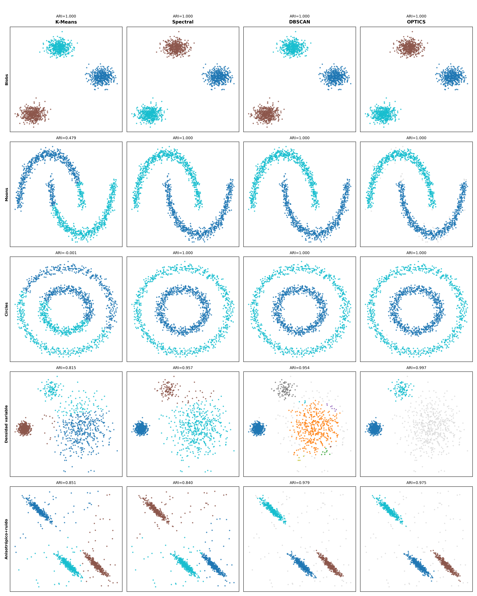
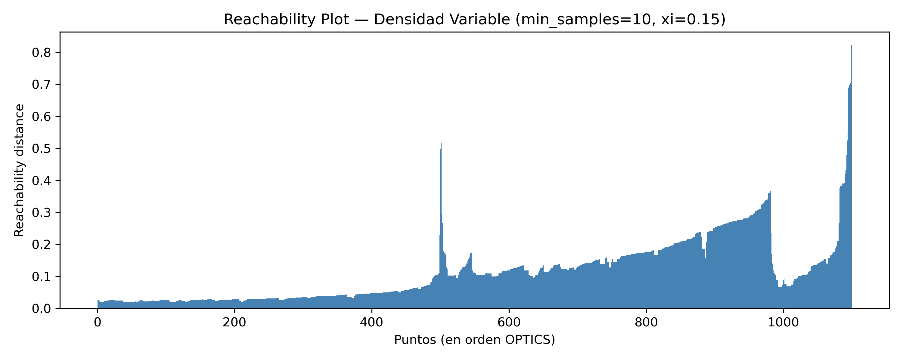
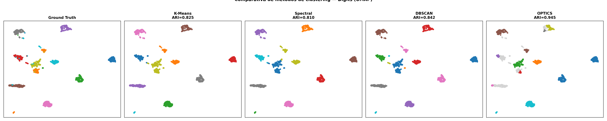
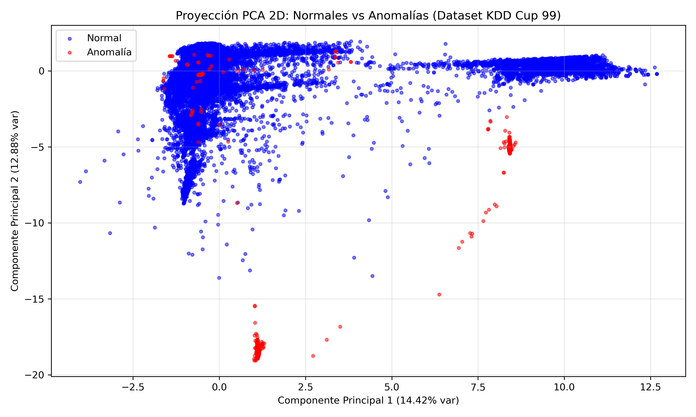
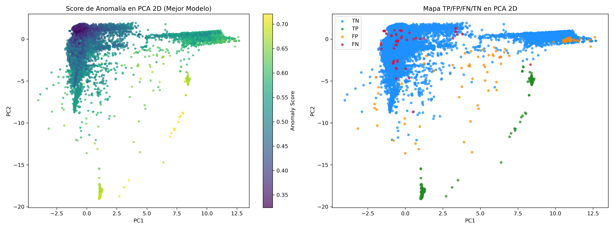
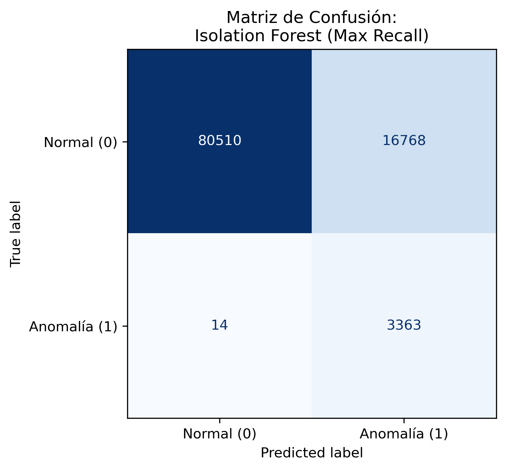

# Clustering and Anomaly Detection: An Unsupervised Learning Benchmark

A systematic comparison of unsupervised learning algorithms across three kinds of data: **synthetic 2D scenarios designed to expose each algorithm's failure modes**, **handwritten digits projected with UMAP**, and **network intrusion data (KDD Cup 99)**.

The project is split into two parts:

1. **Clustering**: K-Means, Spectral Clustering, DBSCAN and OPTICS, evaluated on five synthetic scenarios and on Digits.
2. **Anomaly detection**: Gaussian Mixture Models, Isolation Forest and DBSCAN used as intrusion detectors on a highly imbalanced dataset (3.36% attacks).

## Key Findings

- **Each algorithm fails in a predictable way.** K-Means breaks on non-convex shapes (ARI of -0.0006 on concentric circles), DBSCAN breaks when clusters have different densities (a single global `eps` cannot fit both), and OPTICS is the most flexible but the most sensitive to its parameters (ARI between 0.04 and 0.997 depending on `xi`).
- **Internal metrics can mislead.** K-Means scores a Silhouette of 0.35 on concentric circles while its ARI is zero. Silhouette rewards the compact, convex shapes K-Means is built to find, whether or not they match reality.
- **Noise handling matters.** On Digits, OPTICS reached **ARI 0.9455** by labelling 26.7% of ambiguous points as noise instead of forcing them into a cluster, compared with 0.8419 for DBSCAN and 0.8248 for K-Means (which assign every point).
- **For anomaly detection, Isolation Forest is the only viable option here.** It reaches ROC-AUC 0.94, while GMM (0.28) and DBSCAN (recall 0.04) fail to separate attacks from normal traffic.
- **Threshold choice drives the trade-off.** With `contamination=0.20`, Isolation Forest detects 3,363 of 3,377 attacks (recall 0.996) but raises 16,768 false alarms. With `contamination=0.01`, precision is 0.91 but recall drops to 0.27.

## Part 1: Clustering

### Synthetic scenarios

Five 2D scenarios, each targeting a specific weakness: **Blobs** (the easy case), **Moons** and **Circles** (non-convex), **Variable density**, and **Anisotropic + noise**.

| Scenario | K-Means | Spectral | DBSCAN | OPTICS |
|---|---|---|---|---|
| Blobs | 1.0000 | 1.0000 | 1.0000 | 1.0000 |
| Moons | 0.4785 | 1.0000 | 1.0000 | 1.0000 |
| Circles | -0.0006 | 1.0000 | 1.0000 | 1.0000 |
| Variable density | 0.8150 | 0.9567 | 0.9538 | 0.9973* |
| Anisotropic + noise | 0.8507 | 0.8405 | 0.9789 | 0.9746 |

*Adjusted Rand Index (ARI), best configuration per method. \*With `xi` extraction, OPTICS labels the sparse cluster as noise (45% of points); extracting clusters with a DBSCAN-style cut instead recovers all three clusters (ARI 0.9959, 9.3% noise).*

<p align="center">
  
</p>

The reachability plot makes the variable-density case readable: each valley is a cluster, and the valley depth reflects its density.

<p align="center">
  
</p>

### Digits (UMAP 2D projection)

| Method | Config | Clusters | Noise | ARI | NMI | Time (s) |
|---|---|---|---|---|---|---|
| K-Means | K=10 | 10 | 0.0% | 0.8248 | 0.8912 | 0.091 |
| Spectral | RBF, gamma=1.0 | 10 | 0.0% | 0.8104 | 0.8798 | 0.396 |
| DBSCAN | eps=0.1, min_samples=5 | 14 | 0.0% | 0.8419 | 0.8994 | 0.013 |
| **OPTICS** | min_samples=20, xi=0.15 | 13 | 26.7% | **0.9455** | **0.9482** | 1.509 |

<p align="center">
  
</p>

Practical takeaway: DBSCAN is the fastest and easiest to tune (via the k-distance plot), so it is a good first attempt on unlabelled data. OPTICS is worth the extra cost and tuning effort when densities vary or ambiguous points should be left unassigned.

## Part 2: Anomaly Detection

**Dataset:** KDD Cup 99 (SA subset), 100,655 connections, 41 features, 3,377 attacks (3.36%). Labels are used only for evaluation. Since a missed attack is far more costly than a false alarm, **recall** is the main metric, with ROC-AUC and Average Precision used to judge the quality of the underlying score.

<p align="center">
  
</p>

| Model | Config | Precision | Recall | F1 | ROC-AUC | AP |
|---|---|---|---|---|---|---|
| GMM | K=15, diagonal covariance, 95th percentile | 0.134 | 0.200 | 0.161 | 0.278 | 0.055 |
| **Isolation Forest** | 100 trees, contamination=0.20 | 0.167 | **0.996** | 0.286 | **0.941** | 0.452 |
| DBSCAN | eps=0.5, min_samples=10 | 0.010 | 0.038 | 0.016 | N/A | N/A |

### Isolation Forest: the contamination trade-off

| contamination | Precision | Recall | F1 |
|---|---|---|---|
| 0.01 | 0.912 | 0.272 | 0.419 |
| 0.05 | 0.185 | 0.275 | 0.221 |
| 0.10 | 0.168 | 0.496 | 0.251 |
| 0.15 | 0.223 | 0.995 | 0.364 |
| 0.20 | 0.167 | 0.996 | 0.286 |

ROC-AUC stays at 0.94 regardless of `contamination`, so the ranking quality of the score is stable and the parameter only moves the operating point. Note that `contamination=0.15` offers almost the same recall as 0.20 with better precision and F1.

<p align="center">
  
  
</p>

### Why GMM and DBSCAN fail

- **GMM** is fitted on mixed normal and attack traffic, so it also models the attacks' density. Its ROC-AUC (0.28) is below chance, meaning the score ranks attacks as *more* likely than normal traffic. BIC kept decreasing up to the largest K tested (15), so the mixture is probably under-fitted.
- **DBSCAN** has no useful density gap to exploit: the k-distance plot is flat for ~100,000 points, so attacks are absorbed into the main cluster in a 41-dimensional space where Euclidean distances lose meaning.

## Repository Structure

```
.
├── README.md
├── Practica_2.ipynb       # Full analysis: clustering + anomaly detection
├── Memoria_P2.pdf         # Written report (Spanish)
└── images/                # Figures generated by the notebook
```

## Getting Started

```bash
git clone https://github.com/<your-username>/<repo-name>.git
cd <repo-name>
pip install numpy pandas scikit-learn matplotlib seaborn umap-learn jupyter
```

Open `Practica_2.ipynb` and run the cells in order. Datasets are loaded inside the notebook (Digits and KDD Cup 99 are available through scikit-learn).

**Stack:** Python, scikit-learn, UMAP, NumPy, pandas, Matplotlib, Seaborn.

## Limitations and Future Work

- Clustering on Digits is done on a 2D UMAP projection, which already separates the classes well. Results on the raw 64-dimensional data would be a harder and more informative test.
- OPTICS results depend heavily on `min_samples` and `xi`, and were tuned using the ground-truth labels. Without labels, that tuning would have to rely on internal criteria.
- GMM was trained on mixed data. Training it (or Isolation Forest) only on normal traffic, as a novelty detector, is the natural next experiment.
- Other detectors worth comparing: Local Outlier Factor, One-Class SVM and autoencoders. The decision threshold could also be chosen from the precision-recall curve rather than from `contamination`.

## Author

**Izan Cuesta Corbí**
University of Alicante, Escuela Politécnica Superior
Contact: icc87@alu.ua.es

*Originally developed as coursework for the Advanced Learning course (2025/2026). The written report is in Spanish.*
